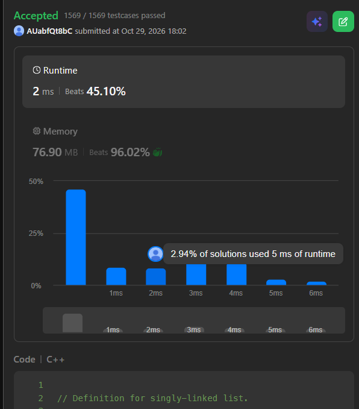

# 2. Add Two Numbers

Medium — https://leetcode.com/problems/add-two-numbers/

## Example

```
Input:  l1 = [2,4,3], l2 = [5,6,4]
Output: [7,0,8]
```

## Complexity

- Time: O(max(n, m))
- Space: O(1) auxiliary

## Result


